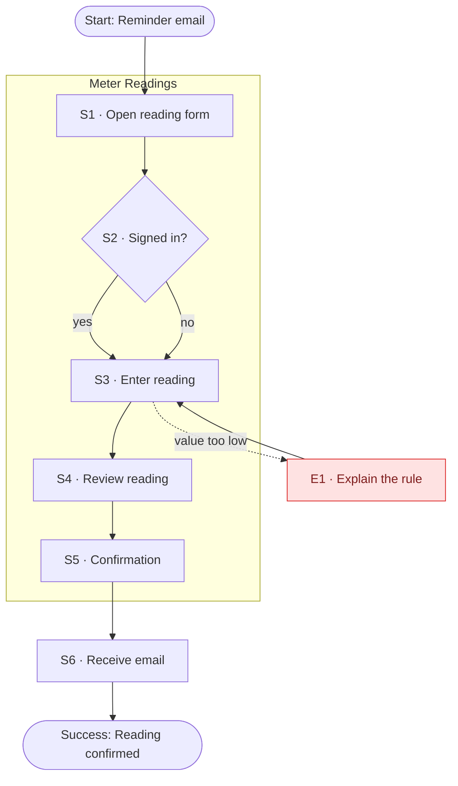

# Submit meter reading

## Overview
A tenant submits the yearly meter reading, from the reminder email to the confirmation.

## Context
- **User:** Ana (`cautious-first-timer`)
- **Intent:** Submit the reading before the deadline
- **Trigger:** Reminder email
- **Success:** Reading accepted and confirmed
- **User state:** first-time, on mobile

## Rules
- **R1** — Readings below the previous value are rejected
- **R2** — The user must be signed in

## Flow Diagram

## Steps

| # | Step | User action | System response | State | Section / Screen | Rules |
|---|------|-------------|-----------------|-------|------------------|-------|
| S1 | Open reading form | Taps the link in the email | Shows the form | `idle` | `meter-readings` / `ReadingForm` | — |
| S2 | Signed in? | Signs in if needed | Checks the session | `auth` | `account` / `Login` | R2 |
| S3 | Enter reading | Types the value | Validates inline | `editing` | `meter-readings` / `ReadingForm` | R1 |
| S4 | Review reading | Checks the value | Shows a summary | `review` | `meter-readings` / `ReadingReview` | — |
| S5 | Confirmation | Reads the confirmation | Shows success | `done` | `meter-readings` / `ReadingConfirmation` | — |
| S6 | Receive email | — | Sends a confirmation email | `done` | — | — |

## Edge Cases

| # | Failure | Trigger | Handling | Returns to |
|---|---------|---------|----------|-----------|
| E1 | Value too low | Reading below the previous value | Explain the rule and keep the input | S3 |

## Prototype Mapping

| Step | Section | Screen design | Status | Missing |
|------|---------|---------------|--------|---------|
| S1 | `meter-readings` | `ReadingForm` | exists | — |
| S2 | `account` | `Login` | exists | — |
| S3 | `meter-readings` | `ReadingForm` | partial | inline error state |
| S4 | `meter-readings` | `ReadingReview` | exists | — |
| S5 | `meter-readings` | `ReadingConfirmation` | exists | — |
| S6 | — | — | gap | email template |

## Open Questions
- [ ] Is a photo upload required?
