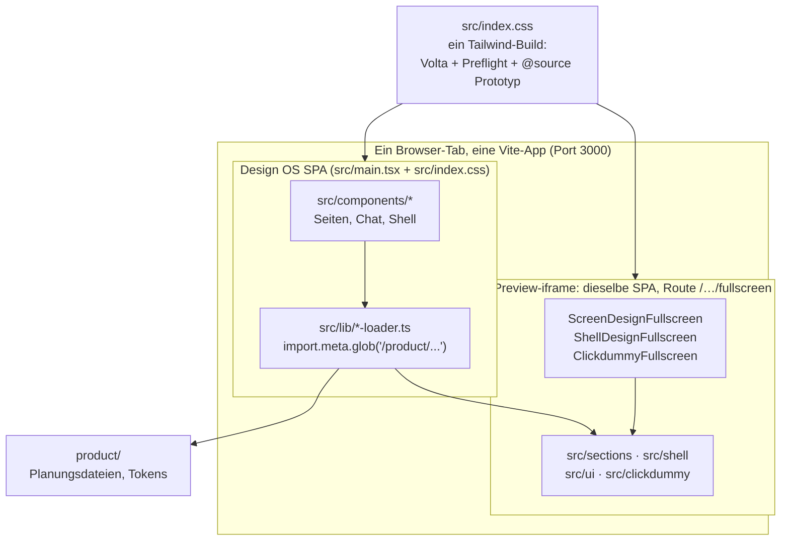
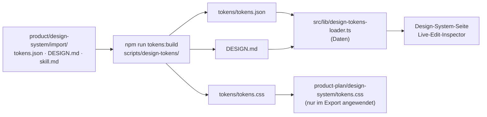
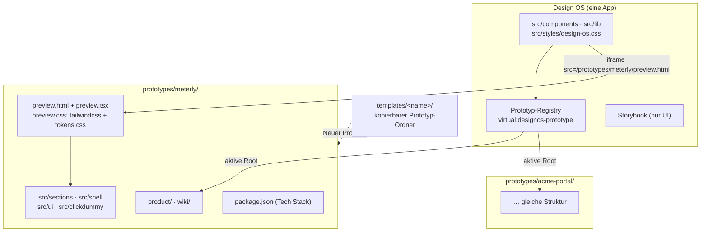

# Trennung von Design OS UI und Prototyp

Stand: 2026-10-27, Branch `feat/liveedit`

## 1. Ziel

Design OS ist das Planungswerkzeug, der Prototyp ist das Produkt, das darin entsteht. Später sollen in einem
Design OS **mehrere Prototypen** und **Templates** laufen. Das geht nur, wenn beide Seiten strikt getrennt sind:

| Kriterium | Bedeutung |
|---|---|
| **K1 Eigener CSS-Build** | Der Prototyp wird mit seinem eigenen Tailwind-Build und seinen eigenen Tokens (`tokens.css`) gestylt. Er erbt nichts vom Design-OS-Theme (Preflight, Base-Layer, Volta, Fonts). |
| **K2 Eigenes Dokument** | Der Prototyp läuft in einem eigenen Dokument (iframe mit eigenem HTML-Entry), nicht in einer Route der Design-OS-SPA. |
| **K3 Eigener Abhängigkeitsgraph** | Der Prototyp importiert nichts aus Design OS und umgekehrt. Pakete aus seinem Tech Stack landen nicht in der App. |
| **K4 Daten über eine Prototyp-Root** | Design OS liest Planungsdateien und Komponenten über **eine** konfigurierbare Wurzel, nicht über feste Pfade. |
| **K5 Keine geteilten Komponenten** | Die Design-OS-UI (`src/components/ui`) und die Produkt-UI (`src/ui`) teilen keinen Code und kein Theme. |

## 2. Ist-Zustand auf einen Blick

Kurz gesagt: Der Prototyp ist **organisatorisch** getrennt (eigene Ordner, Import-Guards, Token-Guards). **Technisch** läuft er
aber im selben Build, im selben CSS und im selben React-Baum wie Design OS. Der iframe isoliert nur das Layout, nicht den Code.

## 3. Ist-Zustand je Ebene

### 3.1 Komponenten

| | Design OS UI | Prototyp |
|---|---|---|
| Ort | `src/components/` (inkl. `src/components/ui/`, 16 shadcn-Primitives) | `src/sections/`, `src/shell/`, `src/ui/`, `src/clickdummy/` |
| Primitives | shadcn mit semantischen Utilities (`bg-primary`, …), aufgelöst gegen das Volta-Theme | `src/ui/` mit Palettenstufen (`bg-teal-600`) und `{/* token: primary */}`-Kommentaren |
| Import-Regeln | darf Prototyp-Komponenten nur über Loader laden (`import.meta.glob`) | darf nichts aus `@/components/*`, keine Token-Loader und kein globales CSS importieren |

**Bereits durchgesetzt** (`scripts/design-tokens/tests/separation.test.mjs`):

- Produktcode importiert weder `@/components/*` noch die Token-Loader noch CSS.
- Produktcode nutzt keine semantischen Design-OS-Utilities (`bg-primary`, `text-muted-foreground`, …).
- `src/ui/` existiert als eigene Schicht und nutzt Palettenstufen.

**Lecks:**

- **Live Edit greift in den Prototyp ein.** `scripts/babel-source-attr.mjs` (`DEFAULT_INCLUDE = ['src/sections/', 'src/shell/', 'src/ui/']`) schreibt im Dev-Build `data-dos-src` in die Prototyp-Elemente. `useLivePicker()` aus `src/components/live-edit/` läuft **im** Prototyp-Dokument (`ScreenDesignPage.tsx`, `ShellDesignPage.tsx` in den Fullscreen-Komponenten). Die Verbindung zum Design-OS-Teil (postMessage, `src/lib/live-edit/protocol.ts`) ist sauber, der Picker-Code ist aber Design-OS-Code im Prototyp-Bundle.
- **Fullscreen-Komponenten sind Design-OS-Komponenten.** `ScreenDesignFullscreen`, `ShellDesignFullscreen` und `ClickdummyFullscreen` liegen in `src/components/` und rendern den Prototyp. Sie sind die Brücke und gehören heute keiner Seite eindeutig.
- **`FlowWalkBar`** (`src/components/FlowWalkBar.tsx`) wird laut Kommentar vom Clickdummy (`src/clickdummy/ClickdummyApp.tsx`) gerendert. Das ist eine Design-OS-Komponente im Prototyp, und der Guard verbietet genau diesen Import (`@/components/*`).

### 3.2 Tailwind und CSS

Vor diesem Umbau war `src/index.css` **ein** Stylesheet für alles: `@import "tailwindcss"` (automatische Source-Erkennung über das ganze Repo), dazu `@source "../src/shell"` und `@source "../src/sections"`, das Volta-Theme (`app-theme.css`), die shadcn-Variablen und der Base-Layer.

**Mit diesem Umbau (erster Trennungsschritt):**

- `src/styles/design-os.css` ist das Stylesheet der Design OS UI: `@import "tailwindcss" source(none)` und `@source` nur auf `src/components` und `src/lib`. Storybook lädt ausschließlich diese Datei.
- `src/index.css` importiert es und hängt die Prototyp-Quellen an (`./shell`, `./sections`, `./ui`, `./clickdummy`). Die laufende App verhält sich unverändert.
- Ein Guard prüft, dass `design-os.css` nur App-Quellen scannt (`separation.test.mjs`).

**Weiterhin offen:**

| Leck | Wirkung im Prototyp |
|---|---|
| Der Preview-iframe lädt `src/main.tsx` und damit `index.css` | Preflight, Base-Layer (`* { border-border }`, `body { bg-background text-foreground font-sans }`), Inter und `h1–h6 { font-display }` kommen aus Design OS |
| `@custom-variant dark (&:is(.dark *):not(:is(.light *)))` | Der Dark Mode des Prototyps folgt der Design-OS-Variante und der `dark`-Klasse auf `<html>`, die die Fullscreen-Komponenten aus `localStorage['theme']` setzen |
| Volta-Paletten (`rwe-*`, `brand-blue-*`, `energy-green-*`) sind im selben Build | Ein Screen Design kann `bg-brand-blue-500` benutzen, ohne dass ein Guard anschlägt |
| Semantische Utilities resolven im iframe auf Volta | Darum muss der Prototyp Palettenstufen benutzen. Die echten Tokens (`tokens.css`) sieht er erst im Export. |

### 3.3 DESIGN.md und Tokens

- **Gut getrennt:** Die App liest Tokens nur als Daten über einen einzigen Loader. `tokens.css` wird in Design OS nie geladen (Guards: „Design OS app never loads the product tokens.css“, „product token files are read only by the token loader“).
- **Folge der fehlenden Laufzeit-Trennung:** Weil der Prototyp im Design-OS-CSS läuft, kann er `tokens.css` nicht laden, sonst würde er das App-Theme überschreiben. Deshalb arbeiten Screen Designs mit Palettenstufen plus Token-Kommentaren, und der Export mappt sie zurück. Die Vorschau zeigt also eine Annäherung, nicht die echten Tokens. Ein eigener Prototyp-Build (K1) würde diesen Umweg überflüssig machen.

### 3.4 Daten und Loader

Zehn Loader in `src/lib/` binden feste Pfade per `import.meta.glob` ein:

| Loader | Pfade |
|---|---|
| `product-loader.ts` | `/product/*.md`, `/product-plan.zip`, `/src/clickdummy/ClickdummyApp.tsx` |
| `section-loader.ts` | `/product/sections/*/{spec.md,data.json,*.png}`, `/src/sections/*/*.tsx` |
| `shell-loader.ts` | `/product/shell/*.md`, `/src/shell/components/*.tsx`, `/src/shell/*.tsx` |
| `design-system-loader.ts`, `design-tokens-loader.ts` | `/product/design-system/...` |
| `data-shape-loader.ts`, `flow-loader.ts`, `persona-loader.ts`, `techstack-loader.ts` | `/product/{data-shape,flows,personas,techstack}/...` |
| `wiki-loader.ts` | `/wiki/**/*.md` |
| zusätzlich `ClickdummyFullscreen.tsx` | eigener Glob auf `/src/clickdummy/ClickdummyApp.tsx`, am Loader vorbei |

Dazu kommen `getProjectModel()` (`src/lib/project-model.ts`) mit einem Modul-Cache und `wiki-loader.ts`, das seine Seiten beim Import berechnet. **Es gibt genau ein Produkt pro Checkout.** Für mehrere Prototypen ist das der größte Blocker (K4).

Storybook zeigt, dass die Loader schon heute austauschbar sind: `.storybook/fixture-globs.ts` biegt jedes dieser Globs per Vite-Plugin auf `.storybook/fixtures/` um, ohne die Loader anzufassen. Dasselbe Prinzip, aber über eine **aktive Prototyp-Root** statt fester Fixtures, ist der Weg zu K4.

### 3.5 Runtime und Abhängigkeiten

- Eine `package.json`, ein `node_modules`, eine React-Instanz. Pakete aus dem Tech Stack des Prototyps (z. B. ein Chart-Paket) werden in die Design-OS-`package.json` installiert. Zwei Prototypen mit unterschiedlichen Stacks wären heute nicht möglich.
- Der Prototyp läuft im Router der SPA (`src/lib/routes.tsx`: `/prototype/.../fullscreen`, `/design-system/shell/fullscreen`, `/prototype/preview/fullscreen`).
- `tsconfig.app.json` und der Alias `@/` gelten für beide Seiten. Ein Prototyp könnte `@/lib/...` importieren; der Guard verbietet nur `@/components/*` und die Token-Loader.

### 3.6 Export

`.claude/commands/design-os/export-product.md` kopiert `src/shell/components`, `src/sections/*/components`, `src/ui` und die Typen nach `product-plan/` und mappt die Palettenstufen über `tokens.css` zurück auf semantische Utilities. Das funktioniert, setzt aber das Singleton-Produkt voraus (`product/` → `product-plan/`).

## 4. Leck-Matrix

| # | Leck | Kriterium | Schwere | Guard |
|---|---|---|---|---|
| L1 | Preview-iframe lädt die Design-OS-SPA inkl. `index.css` | K1, K2 | hoch | nein |
| L2 | Ein Tailwind-Build für App und Prototyp in der laufenden App | K1 | hoch | teilweise (`design-os.css` ist jetzt sauber, `index.css` bündelt weiterhin) |
| L3 | Feste `/product`- und `/src/sections`-Pfade in zehn Loadern | K4 | hoch | nein |
| L4 | Eine `package.json` für App und Prototyp-Stack | K3 | hoch | nein |
| L5 | Volta-Paletten im Prototyp nutzbar | K1, K5 | mittel | nein |
| L6 | `dark`-Variante und Theme-Sync aus Design OS | K1 | mittel | nein |
| L7 | Live-Edit-Picker und Fullscreen-Komponenten im Prototyp-Bundle | K3 | mittel | nein |
| L8 | `FlowWalkBar` aus `src/components` im Clickdummy | K3, K5 | mittel | Guard verbietet den Import, die Architektur verlangt ihn |
| L9 | Alias `@/lib/*` aus Prototyp-Code erreichbar | K3 | niedrig | nein |
| L10 | Produkt-Tokens werden in der Vorschau nur angenähert | K1 | niedrig | – (Folge von L1/L2) |
| ✓ | Produktcode importiert keine Design-OS-UI und kein globales CSS | K3, K5 | – | ja |
| ✓ | Design OS lädt `tokens.css` nie, Tokens nur als Daten | K1 | – | ja |
| ✓ | Storybook der Design OS UI lädt keinen Prototyp | K3 | – | ja (`tests/storybook.test.ts`) |

## 5. Zielarchitektur

1. **Ein Ordner pro Prototyp:** `prototypes/<id>/` enthält `product/`, `src/{sections,shell,ui,clickdummy}`, `wiki/`, `preview.html`, `preview.tsx`, `preview.css` und optional eine eigene `package.json` (pnpm-Workspace).
2. **Eigener Preview-Entry (K1, K2):** Der iframe lädt `prototypes/<id>/preview.html` (Vite Multi-Page oder ein eigener Vite-Server je Prototyp), nicht eine SPA-Route. `preview.css` = `@import "tailwindcss" source("./src")` + `@import "./product/design-system/tokens/tokens.css"`. Der Prototyp sieht dann die **echten** Tokens und kann semantische Utilities direkt nutzen. Der Mapping-Umweg im Export entfällt.
3. **Loader über eine Prototyp-Root (K4):** Ein virtuelles Modul `virtual:designos-prototype` (Vite-Plugin, gleiches Prinzip wie `.storybook/fixture-globs.ts`) liefert die Globs der aktiven Root. Die Auswahl erfolgt per Env (`DESIGNOS_PROTOTYPE=meterly`) oder per UI mit Neustart bzw. HMR. Modul-Caches (`project-model.ts`, `wiki-loader.ts`) werden pro Root geschlüsselt.
4. **Bridge-Paket statt geteilter Komponenten (K3, K5):** Was im Prototyp-Dokument laufen muss (Live-Edit-Picker, Flow-Walk-Bar, Theme-Sync), wird ein kleines Paket `src/preview-bridge/` ohne Abhängigkeit zu `@/components` und ohne Design-OS-CSS. Es spricht nur über das postMessage-Protokoll mit Design OS. Die Fullscreen-Komponenten werden zu Preview-Entries.
5. **Templates:** Ein Template ist ein Prototyp-Ordner unter `templates/<name>/`. „Neuer Prototyp aus Template“ kopiert ihn nach `prototypes/<id>/`.
6. **Storybook bleibt UI-only.** Es behält seine Fixture-Root; der Guard-Test bleibt bestehen.

## 6. Migrationsschritte

Jeder Schritt bekommt einen Guard-Test, bevor der nächste beginnt.

| # | Schritt | Guard | Status |
|---|---|---|---|
| 1 | CSS-Split: `src/styles/design-os.css` scannt nur App-Quellen, `index.css` hängt den Prototyp an | `separation.test.mjs`: Design-OS-CSS hat nur App-`@source`s | **erledigt** |
| 2 | Storybook nur für die Design OS UI, Loader auf Fixtures umgebogen | `tests/storybook.test.ts` | **erledigt** |
| 3 | Eigener Preview-Entry (`preview.html` + `preview.css` mit `tokens.css`); Fullscreen-Routen entfallen | Prototyp-Bundle enthält kein `design-os.css`, kein `@/components` | offen |
| 4 | `src/preview-bridge/` für Live-Edit-Picker, Flow-Walk und Theme-Sync | Bridge importiert nichts aus `@/components`, `@/lib/*-loader` | offen |
| 5 | `index.css` ohne Prototyp-`@source`s (folgt aus 3) | `index.css` == App-Quellen | offen |
| 6 | Loader auf `virtual:designos-prototype` umstellen, Caches pro Root | kein `import.meta.glob('/product` in `src/lib` | offen |
| 7 | Ordner `prototypes/<id>/`, Migration des bestehenden Produkts nach `prototypes/default/` | alle Pfade über die Registry | offen |
| 8 | Export pro Prototyp (`prototypes/<id>/product-plan/`) | Export-Snapshot-Test | offen |
| 9 | Eigene `package.json` pro Prototyp (pnpm-Workspace), Tech-Stack-Installationen dorthin | App-`package.json` enthält keine Stack-Pakete | offen |
| 10 | Templates: `templates/<name>/` + Befehl „Neuer Prototyp“ | Template ist ein gültiger Prototyp (Smoke-Test) | offen |

Die Schritte 3 bis 5 lösen L1, L2, L5, L6, L7, L8 und L10 und bringen schon für **einen** Prototyp echte Tokens in die Vorschau.
Die Schritte 6 bis 10 sind die Voraussetzung für mehrere Prototypen und Templates.

## 7. Offene Fragen und Risiken

- **Ein Vite-Server oder mehrere?** Multi-Page in einem Server ist einfacher (ein Port, ein HMR), teilt aber `node_modules`. Ein Server pro Prototyp isoliert Abhängigkeiten vollständig, braucht aber Port-Verwaltung wie bei OpenCode (`scripts/opencode-dev.mjs`).
- **Agent-Befehle:** Alle Befehle in `.claude/commands/design-os/` schreiben nach `product/` und `src/sections`. Sie müssen die aktive Root kennen (z. B. über `npm run context`, das die Root ausgibt).
- **Wiki:** Gehört das Wiki zum Prototyp (Produktwissen) oder zu Design OS (`wiki/how-to/`)? Vorschlag: `how-to` bleibt in Design OS, alles andere wandert in den Prototyp.
- **Live Edit:** Das Babel-Plugin braucht die Root als Option (`DEFAULT_INCLUDE` pro Prototyp).
- **E2E-Tests** (`e2e/`) gehen von festen Routen aus und müssen auf die Preview-Entries umgestellt werden.
