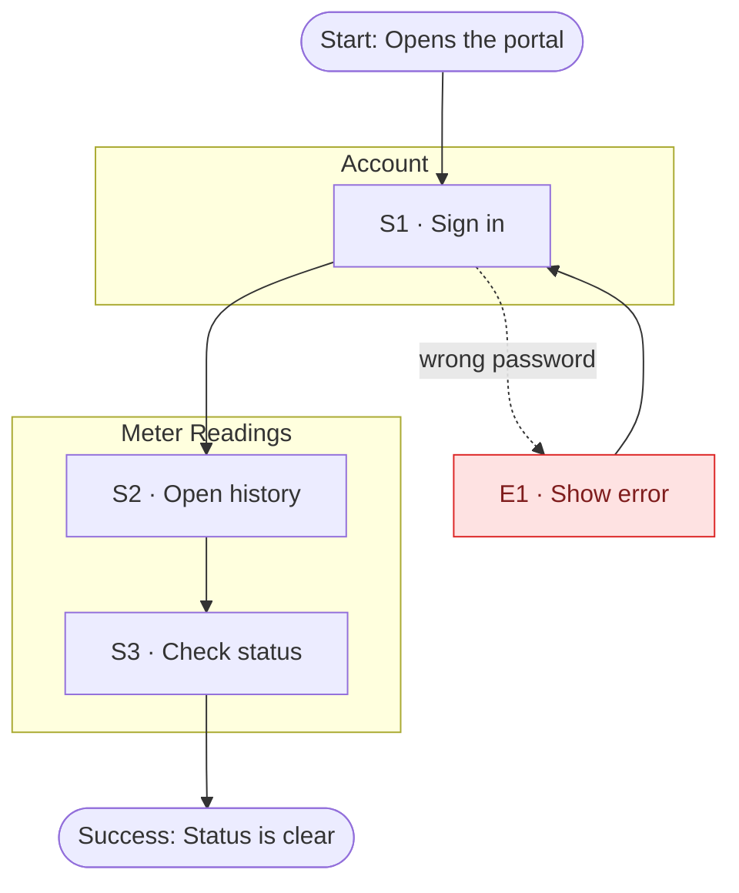

# Browse reading history

## Overview
A signed-in user opens the history and checks the status of past readings.

## Context
- **User:** Marta (`property-manager`)
- **Intent:** See which readings are accepted
- **Trigger:** Billing deadline comes close
- **Success:** The status of every reading is clear
- **User state:** returning, on desktop

## Rules
- **R1** — Only signed-in users see readings
- **R2** — Rejected readings show the reason

## Flow Diagram

## Steps

| # | Step | User action | System response | State | Section / Screen | Rules |
|---|------|-------------|-----------------|-------|------------------|-------|
| S1 | Sign in | Enters email and password | Checks the credentials | `auth` | `account` / `Login` | R1 |
| S2 | Open history | Opens the history | Shows all readings | `list` | `meter-readings` / `ReadingHistory` | R1 |
| S3 | Check status | Scans the status column | Shows rejection reasons | `list` | `meter-readings` / `ReadingHistory` | R2 |

## Edge Cases

| # | Failure | Trigger | Handling | Returns to |
|---|---------|---------|----------|-----------|
| E1 | Wrong password | Credentials do not match | Show an error, keep the email | S1 |

## Prototype Mapping

| Step | Section | Screen design | Status | Missing |
|------|---------|---------------|--------|---------|
| S1 | `account` | `Login` | exists | — |
| S2 | `meter-readings` | `ReadingHistory` | exists | — |
| S3 | `meter-readings` | `ReadingHistory` | exists | — |

## Open Questions
- [ ] Is the history filterable by meter?
