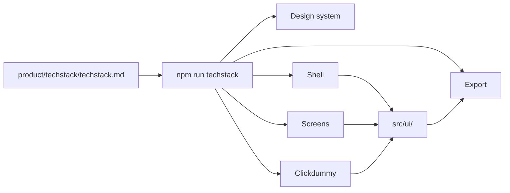

# Tech Stack

## Summary
The tech stack step records what the prototype is built with: the UI library (**shadcn/ui is the default**), the component base, the style, the icons, registries and reference repositories, extra packages, app patterns such as forms, state, tables and charts, tooling, and the framework the export goes into. `/design-os:techstack` (Copilot: `@01-techstack`) decides them in a guided session and stores them in `product/techstack/techstack.md` and in the wiki. Every later step loads the file and follows it. The step is recommended, not blocking: without it the defaults apply (shadcn/ui, lucide-react).

## Why
- **Screens are built from real parts.** Without a decision, every screen design invents its own buttons, dialogs and icons. With one, they all come from the product UI layer `src/ui/` and ship in the export as `product-plan/ui/`.
- **The export fits the target.** Knowing that the target is Next.js with Radix UI means the exported components match the app they land in, and the coding agent does not have to guess.
- **No surprise dependencies.** A package that nobody agreed to is never added. Every package in the file has a reason, and an undecided area gets no library at all.
- **Conflicts surface early.** A library that brings its own styling system, or a base that differs from the target codebase, is found in the session, not after ten screens.
- **Defaults keep it light.** You only decide what you care about. Everything else keeps its default or stays undecided.

## Quick start

```text
/design-os:techstack                 # picks the mode itself: full the first time, update afterwards
/design-os:techstack quick           # one round: target and UI library, defaults for the rest
/design-os:techstack update          # change decisions later
/design-os:techstack add-registry    # add a registry, reference repository or package
```

- **Claude Code:** run the slash command above.
- **GitHub Copilot:** select the `@01-techstack` agent and type the same text without the command, e.g. `@01-techstack quick`.
- **OpenCode:** run the same slash command; OpenCode uses the commands in `.claude/commands`, and questions come through its `question` tool.

The command needs `product/product-overview.md`. If it is missing, it tells you to run `/design-os:product-vision` first. Every question is multiple choice with a recommended answer; nothing is written before you confirm the review step.

## Principles
- **The prototype runtime is fixed.** React 19 with Vite, TypeScript (strict) and Tailwind CSS v4 are shown, never asked. What the **target codebase** uses is a separate decision.
- **shadcn/ui first.** It is offered as the recommendation. Another library is allowed, and the compatibility check states what that costs.
- **Undecided means no dependency.**
- **Nothing is installed here.** This step records decisions. The first design step that needs a package asks you before installing it.

## Step by step

The command first reads the overview, personas, roadmap and flows, the prototype's `package.json` and the wiki, and tells you what it found. Then it asks in rounds (about four or five in `full` mode, two in `quick` mode):

1. **Target codebase.** Greenfield, an existing codebase, or not decided yet. Then the target framework: Next.js (App Router), Vite + React, React Router / Remix, or another. For an existing codebase it asks for its repositories and treats what the codebase already uses as the recommendation in every later round. Without a mode it asks whether you want only the defaults (`quick`) or a walk through all areas (`full`).
2. **UI library, base, style, icons.** shadcn/ui (recommended), headless primitives (Radix UI, Base UI, React Aria), another component library, or none. With shadcn/ui: Radix UI or Base UI as the base, a UI style (`new-york` by default), and the icon set (`lucide-react`, Phosphor, Tabler, Heroicons). Colors, fonts and radius never come from the style; they come from the design system.
3. **Registries, repositories and packages.** The official shadcn registry only (recommended), community registries, a private registry with a URL template, GitHub repositories to copy patterns from, and extra packages the product hints at (rich text, drag and drop, date picker, maps). For each entry the command records name, kind, location and what it is used for. It checks what it can read-only (`npx shadcn@latest search @<namespace>`, whether a repository URL resolves) and marks the rest `unverified`. It notes the license of every repository whose code will be copied.
4. **App patterns** (full mode). Only the areas your product gives a reason for: forms and validation, data fetching, state, tables, charts, animation, routing, i18n.
5. **Tooling** (full mode). Package manager, testing and linting, accessibility level (WCAG 2.2 AA is recommended), browser support.
6. **Compatibility check.** A critic persona looks for ways the stack could fight the prototype, the tokens or the target codebase and presents the findings as one question, so you decide what to fix:
   - a library with its own styling system (Mantine, MUI, Chakra, HeroUI) against Tailwind and the tokens
   - a Next.js target with server components: exported components that hold state need `'use client'`
   - a base that differs from the target codebase's
   - more than five extra packages, or two libraries for the same area
   - a persona or accessibility level the library cannot serve
   - a section that needs a table or chart while `tables` or `charts` is undecided
   - entries marked `unverified`
7. **Review and write.** A compact summary, then `Write tech stack` or `Change something`. The file is written, validated with `npm run -s techstack -- --check`, and compiled into the wiki.

## What you get

| Where | What |
|-------|------|
| `product/techstack/techstack.md` | The source. Edit it only through `/design-os:techstack update` or `add-registry`. |
| `wiki/techstack/techstack.md` | The compiled wiki page; `wiki/techstack/Home.md` is the domain index |
| `product-plan/techstack.md` | A copy in the export (created by `/export-product`) |
| `product-plan/ui/` | The product UI primitives from `src/ui/` (created by `/export-product`) |

The file has a summary, a decisions table with one row per area, and optional tables for registries and repos and for packages, plus constraints and open questions:

```markdown
---
status: confirmed
updated: 2026-10-14
---

# Tech Stack

## Summary

shadcn/ui on Radix UI, integrated into an existing Next.js 15 app.

## Decisions

| Area | Choice | Source | Rationale |
|------|--------|--------|-----------|
| framework | React 19 + Vite | default | Runtime of the Design OS prototype |
| ui-library | shadcn/ui | default | Components are copied as source code and styled with Tailwind |
| ui-base | Radix UI | chosen | The target codebase uses Radix UI |
| icons | lucide-react | default | |
| state | none | chosen | useState and context are enough |
| target-framework | Next.js 15 (App Router) | existing | The export is integrated there |

## Registries and Repos

| Name | Kind | Location | Used for |
|------|------|----------|----------|
| acme/portal | github-repo | https://github.com/acme/portal | Reference for existing patterns (MIT) |
```

`Source` is `default` (nobody decided), `chosen` (you picked it), `existing` (the target codebase uses it) or `constraint` (mandated from outside). Areas that are not in the table keep their default or stay undecided. Whether a package is installed is never written to the file: `npm run techstack` works it out from `package.json`.

## How later steps follow it

Every step from the design system onwards runs `npm run -s techstack` before its first question and tells you in one line which stack applies. The decisions are binding:



- **UI primitives come from `src/ui/`.** Screens, shell and clickdummy import button, dialog and the rest only from there, never from `@/components/*` (that is the Design OS UI, with the Design OS theme). `npm run test:tokens` treats `src/ui/` as a product directory and fails on Design OS semantic utilities such as `bg-primary`.
- **Ported, never added.** With shadcn/ui, a missing primitive is ported with `npx shadcn@latest view @shadcn/<name>` into `src/ui/<name>.tsx`: imports become relative, semantic utilities become the palette steps from `DESIGN.md` with a `token:` comment, and the base and style are respected. `npx shadcn@latest add` is never run, because it would overwrite Design OS UI.
- **Undecided means no dependency.** An area without a decision is built with React, TypeScript and Tailwind. A dependency that is neither in the stack nor in its Packages table is not added; a listed package is installed only after the step asks you.
- **Conflicts are shown, not resolved.** If a request needs something the stack does not have, the step names the area and points you to `/design-os:techstack update`. It never edits the file and never picks a side silently.
- **Registries and repositories come first.** Before writing a component, a step looks in the registries and reference repositories of the stack. A repository is a reference: the pattern is ported, the repository is never vendored, and its license is respected.

What each step does with it:

| Step | What it does with the stack |
|------|-----------------------------|
| Design system | Colors cover the semantic roles the library expects, so `DESIGN.md` maps one to one. Fonts and radius stay the design system's |
| Shell | Built from `src/ui/` primitives and the stack's icons; lists the primitives in `product/shell/spec.md` |
| Shape section | Asks no technology questions; reports a gap if the spec needs something the stack lacks |
| Sample data | Types stay plain TypeScript; notes which fields would be validated |
| Design screen | Composes from `src/ui/`, ports missing primitives, uses only listed packages, reports what it needs |
| Clickdummy | Imports from `src/ui/`, keeps state-based navigation, records the `routing` decision |
| Export | Copies the stack to `product-plan/techstack.md` and `src/ui/` to `product-plan/ui/`, maps palette steps back to semantic utilities with `tokens.css`, and pre-fills "My tech stack" in the prompts |

## Changing it later
- **Change a decision:** `/design-os:techstack update` shows the current decisions, asks what to change and re-runs only the affected rounds and the compatibility check.
- **Add a registry, reference repository or package:** `/design-os:techstack add-registry` asks for name, kind, location and purpose, checks it and appends the row.
- **Steps that already ran are not redone.** After an update the command tells you which are affected: a new `ui-library` affects `src/ui/`, the shell and the screens; a new icon set affects every file that imports icons. Re-run those steps to apply the change.
- **Check the file.** `npm run -s techstack -- --check` validates it (changed runtime areas, unknown or duplicate areas, a non-shadcn library without a package row). `npm run techstack -- --json` prints the same decisions for tools.

## In the wiki
The file is compiled into the `techstack` domain right after it is written: `wiki/techstack/techstack.md` holds the decisions, registries, packages, constraints and open questions, and `wiki/techstack/Home.md` is the domain index. Other steps read it through the stack report, and `/design-os:wiki-query` answers questions such as "why do we use Radix UI?". If the session rejected an alternative with a reason the file does not hold (for example "MUI: the target codebase moved off it in 2025"), run `/design-os:wiki-capture` so the reason reaches `wiki/decisions/`. After changes to the file, `/design-os:wiki-ingest --product` brings the page up to date.

## Common questions
- **Do I have to run it?** No. Without it the defaults apply (shadcn/ui, lucide-react, Tailwind v4) and every step works. Run it when you have an existing codebase, want a different library or icon set, or need packages and registries beyond the defaults.
- **Why does the export ask about my tech stack anyway?** The "My tech stack" section of the prompts is pre-filled from `techstack.md` and only asks about areas that are still undecided.
- **Can I use MUI or Mantine?** Yes. The compatibility check explains the cost: the library is wrapped in `src/ui/` and themed from the tokens, which is extra work per component. shadcn/ui or headless primitives avoid it.
- **Where is the UI style or the color theme?** The UI style (`new-york`, ...) is a shadcn/ui setting. Colors, fonts and radius come from the design system, see [[how-to/design-tokens]].

## Related
- [[how-to/planning-flow]] — where the tech stack fits
- [[how-to/step-by-step]] — every step in detail
- [[how-to/design-tokens]] — the tokens the product UI is themed with
- [[how-to/project-brain]] — how the wiki works
- `wiki/techstack/Home.md` — the tech stack of this project (created with the first run)
